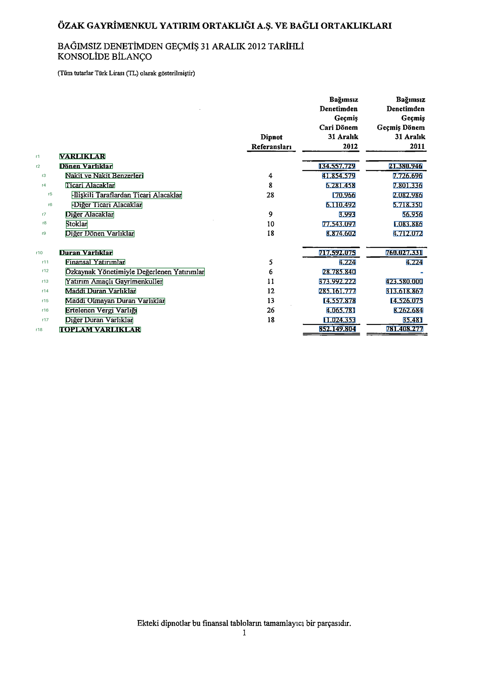
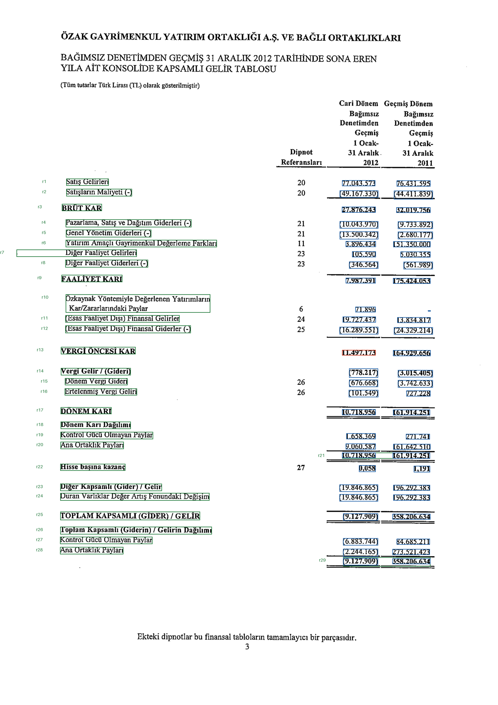
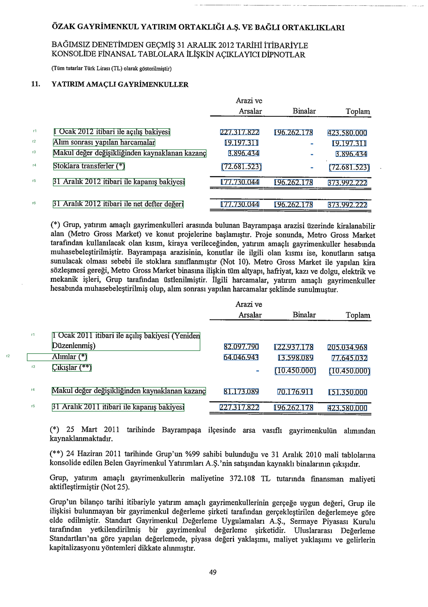

# Finansal Tablo ve Dipnot İlişkilendirme

Bu projede Özak GYO'nun 31.12.2012 tarihli KAP finansal raporundaki özet finansal tablolar çıkarıldı ve dipnot referansı taşıyan finansal tablo satırları ilgili dipnot tablolarındaki satırlarla ilişkilendirildi. Ham OCR metni, sayısal değerler, dönemler, hiyerarşi, konum bilgileri, güven skorları ve doğrulama sonuçları JSON çıktısında birlikte saklandı.

Kaynak: [KAP raporu](https://kap.org.tr/tr/api/file/download/33E83438337C023CE0530A4A622B5826)

PDF 95 sayfadan oluştuğu ve metin katmanı içermediği için OCR tabanlı bir işlem hattı kullanıldı.

## Kurulum ve çalıştırma

Python 3.10 veya üzeri kullanılarak gerekli bağımlılıklar ve model dosyaları aşağıdaki komutlarla hazırlandı.

```bash
python3 -m venv .venv
source .venv/bin/activate
python -m pip install --upgrade pip
python -m pip install "torch>=2.6,<3" --index-url https://download.pytorch.org/whl/cpu
python -m pip install -r requirements.txt --only-binary=tesserocr
python scripts/setup_assets.py --config config.yaml
```

Ana çalışma:

```bash
python main.py --config config.yaml
python -m scripts.show_result
```

Sayfa aralığı ve dipnot numarası kodda sabitlenmedi. İstenirse komut satırından değiştirilebilir.

```bash
python main.py --config config.yaml --pages 5-7 --note 11 \
  --pdf "Özak GYO 31122012 Bağımsız Denetim Raporu.pdf"
```

## Çıktılar

`python -m scripts.show_result` ile şirket, dönemler, bulunan dipnot sayfaları, kurulan ilişkiler, tutar eşitlikleri, güven değerleri ve doğrulama sonuçları özetlendi.

Görsel kontrol için `data/output/previews/page-005.png` benzeri dosyalar üretildi. Satırlar yeşil, hücreler mavi, düşük güvenli hücreler kırmızı çerçeveyle gösterildi.

### Görsel çıktı örnekleri

**Özet finansal tablo, sayfa 5**



**Kapsamlı gelir tablosu, sayfa 7**



**Dipnot 11, sayfa 53**



Başlıca teslim dosyaları:

| Dosya | İçerik |
|---|---|
| [result.json](data/output/result.json) | Belge, özet tablolar, dipnot tabloları, ilişkiler ve doğrulama sonuçları |
| [validation.json](data/output/validation.json) | Yapısal, format ve finansal kontroller |
| [comparison.json](data/output/comparison.json) | İki ilişkilendirme yönteminin aday ve sıralama sonuçları |
| [error_analysis.json](data/output/error_analysis.json) | Düşük güvenli ve hatalı örneklerin analizi |
| [result.schema.json](data/output/result.schema.json) | Üretilen JSON şeması |

JSON yapısında belge → tablo → satır → hücre hiyerarşisi korundu. Hücrelerde `raw`, `value`, `state`, `bbox`, `confidence` ve `low_confidence` alanları tutuldu. Satırlarda ana satır, alt satır ve toplam ilişkileri `parent_id`, `component_ids` ve `aggregation_rule` alanlarıyla gösterildi.

## İşlem adımları

1. **Belge inceleme:** Sayfa sayısı, metin katmanı ve metin kapsaması ölçüldü.
2. **OCR ve önişleme:** Sayfalar görüntüye çevrildi. Gri tonlama, denoise, deskew ve threshold uygulandı. OCR sonucunda metin, bbox ve güven değerleri alındı.
3. **Tablo çıkarımı:** OCR kelime kutuları satırlara ve sütunlara ayrıldı. Tablo başlıkları, dönemler ve dipnot referansları çıkarıldı.
4. **Normalizasyon ve hiyerarşi:** Sayısal değerler ayrıştırıldı. Ana satır, alt satır ve toplam ilişkileri oluşturuldu.
5. **Dipnot tespiti:** Hedef dipnot tüm doküman içinde otomatik olarak arandı. Dipnot 11'in fiziksel 53 ve 54. sayfalarda bulunduğu tespit edildi.
6. **Aday üretimi ve ilişkilendirme:** Özet tablodaki Dipnot 11 referanslı finansal tablo satırları için ilgili dipnot satırları aday olarak üretildi. Embedding ve reranker modelleriyle iki ayrı yöntem çalıştırıldı.
7. **Güven ve doğrulama:** Hücre, satır, tablo ve ilişki seviyesinde güven hesaplandı. Yapısal, format ve finansal kontroller uygulandı.

## OCR ve sayısal normalizasyon

Türkçe ve İngilizce `tessdata_best` verileriyle OCR yapıldı. Belgenin tamamı tek model girdisine verilmedi. Sayfalar ayrı işlenir ve şüpheli hücreler ayrıca kırpılarak yeniden okunur.

Orijinal ve önişlenmiş görüntülerden gelen OCR sonuçları karşılaştırılır. Birden fazla okuma olduğunda ham değerler ve seçim nedeni çıktıda saklanır.

| Ham metin | Değer | Durum |
|---|---:|---|
| `373.992.222` | 373992222 | numeric |
| `(19.846.865)` | -19846865 | numeric |
| `1.234,50` | 1234.5 | numeric |
| `-` | null | dash |
| boş | null | blank |
| `0` | 0 | numeric |
| `%10,5` | 10.5 | numeric, percent |
| `%2-%4` | null | invalid, ham değer korundu |

Nokta binlik, virgül ondalık ayırıcı olarak işlenir. Tire, boş hücre ve sıfır birbirinden ayrı durumlar olarak korundu ve hesaplamalarda birbirine dönüştürülmedi.

## Modeller ve ilişkilendirme yöntemleri

### Yöntem A: Embedding tabanlı sıralama

`intfloat/multilingual-e5-small` modeli kullanıldı. Model girdisine özet tablo başlığı, finansal tablo satırı adı, dipnot referansı, üst satır, dönem, değer ve sütun bağlamı eklendi. Dipnot satırlarına dipnot ve tablo bağlamı verildi.

Embedding benzerliği cosine ile hesaplandı. Sayısal eşitlik ve dönem kapsamı da eklendi. En iyi 8 aday aşağıdaki birleşik puanla sıralandı.

`A = 0.60S + 0.30N + 0.10P`

Burada `S` semantik benzerliği, `N` sayısal uyumu ve `P` dönem kapsamını temsil etti.

### Yöntem B: Embedding ve reranker

Aynı adaylar `cross-encoder/mmarco-mMiniLMv2-L12-H384-v1` modeliyle tekrar puanlandı. Nihai sıralama aşağıdaki birleşik puanla oluşturuldu.

`B = 0.30S + 0.25R + 0.35N + 0.10P`

`R` cross-encoder skorunu temsil etti. Modeller inference amacıyla kullanıldı ve eğitim yapılmadı. Büyük tablolar satır bazında parçalandı. Her satıra tablo bağlamı eklendi ve model girdileri 512 token ile sınırlandı.

Model yüklenemediğinde kullanılabilecek fallback mekanizması tanımlandı. Varsayılan çalışmada fallback kullanılmadı ve iki model de gerçek inference yaptı.

İki hedef finansal tablo satırında Yöntem A ve Yöntem B aynı nihai ilişkilere ulaştı. Buna rağmen aday sıralamalarında farklılıklar gözlendi. Bu nedenle yöntemlerden birinin diğerinden daha başarılı olduğu iddia edilmedi. Bağımsız etiketli veri bulunmadığı için accuracy veya F1 hesaplanmadı.

## Güven hesabı

Güven değerleri doğrudan model skorundan alınmadı. OCR, ayrıştırma, hizalama, dönem uyumu, sayısal eşitlik, aday farkı ve yapısal kanıtlar birlikte değerlendirildi.
| Seviye | Hesap |
|---|---|
| Hücre | `0.55 OCR + 0.25 ayrıştırma geçerliliği + 0.20 sütun hizası`; invalid ×0.35, blank ×0.70; OCR alternatifleri varsa anlaşma oranıyla çarpılır |
| Satır | `R0 = 0.40 ortalama hücre + 0.15 sütun kapsamı + 0.15 geometri + 0.20 etiket OCR + 0.10 referans ayrıştırma`; son güven `0.60R0 + 0.40 yenilenmiş hücre ortalaması` |
| Tablo | `T0 = 0.50 ortalama satır + 0.20 dönem tespiti + 0.15 başlık tespiti + 0.15 ayrıştırma tutarlılığı`; son güven `0.50T0 + 0.50 yenilenmiş satır ortalaması` |
| İlişki | `0.15S + 0.15R + 0.10M + 0.25N + 0.10P + 0.20Q + 0.05H` |

İlişkide `S=clip((cosine-0.5)/0.5)`, R sigmoid(logit), M ilk iki birleşik skor farkının 0.15'e bölünüp kırpılması, N sayısal eşitlik, P dönem kapsamı, Q kaynak/hedef satır-tablo güven ortalaması, H doğru dipnotta bulunma kanıtıdır. Eksik dönem kapsamı güveni ayrıca azaltır.

`low_confidence_threshold: 0.60` altında kayıtlar işaretlenir. Aday marjı 0.03'ten küçükse eşikten bağımsız uyarı verilir.

## Doğrulama sonuçları

Yapısal kontrollerde sayfa ve satır eşleşmeleri, dönem sırası, dipnot referansları ve ilişki kapsamı kontrol edildi. Format kontrollerinde sayı ayrıştırma, para birimi ve OCR alternatifleri incelendi. Finansal kontrollerde alt toplamlar, bilanço denkliği, dönemler arası tutarlılık ve özet tablo ile dipnot tutarlarının eşitliği kontrol edildi.

Önemli sonuçlar:

| Finansal tablo satırı | 2012 | 2011 |
|---|---:|---:|
| Yatırım amaçlı gayrimenkuller | 373.992.222 | 423.580.000 |
| Değerleme farkları | 3.896.434 | 151.350.000 |

Dipnot bileşen kontrolünde `177.730.044 + 196.262.178 = 373.992.222` eşitliği doğrulandı.

İlişki güvenleri:

- Yatırım Amaçlı Gayrimenkuller → **0.762**
- Yatırım Amaçlı Gayrimenkul Değerleme Farkları → **0.705**

| Kontrol grubu | Başarılı | Uyarı | Başarısız |
|---|---:|---:|---:|
| Yapısal | 269 | 0 | 0 |
| Format | 207 | 8 | 0 |
| Finansal | 58 | 7 | 0 |
| Toplam | 534 | 15 | 0 |

Uyarılar başarısız sonuç olarak değerlendirilmedi. Örneğin tire veya boş hücre bulunan finansal denkliklerde bu değerler sıfır kabul edilmedi ve kontrol `warning` olarak bırakıldı.

## Hata analizi

| Örnek | Beklenen | Üretilen ve neden | İyileştirme |
|---|---|---|---|
| 2011 alım toplamı | 77.645.032 | OCR okumaları 71.645.032 ve 77.645.032 arasında ayrıştı. Finansal bileşen toplamıyla uyumlu alternatif seçildi. | İkinci OCR motoru veya görsel doğrulama eklenebilir. |
| Kira artış oranı | %2-%4 aralığı | Ham değer korundu ancak skaler sayı şeması aralığı temsil edemediği için `invalid` üretildi. | Alt ve üst sınırı ayrı tutan bir aralık veri tipi eklenebilir. |
| Değerleme farkı ilişkisi | İki dönemin kazanç satırları | Doğru adayların skorları birbirine yakın olduğu için `candidate_margin_low` uyarısı üretildi. | Dönem bazlı aday marjı ve küçük etiketli kontrol kümesi kullanılabilir. |

Ayrıntılı kayıtlar `data/output/error_analysis.json` içinde saklandı.

## Testler

Sayı durumları, konfigürasyon, dipnot tespiti, hiyerarşi, dönem uyumu, güven hesapları, JSON şeması, OCR davranışı ve finansal kontroller için testler oluşturuldu.

```bash
python -m pytest -q --junitxml=data/output/pytest.xml
```

## Test ve tekrar çalıştırma

Test kümesi 25 odaklı kontrolden oluşur: sayı durumları, konfigürasyon, dipnot tespiti, hiyerarşi, dönem uyumu, güven/şema, PDF metin katmanı, OCR varlıkları, taşınmış önbellek yolu, boş hücrede uzlaşma, dönemleri ters sıralanmış sütunlarla karşılaştırma, hatalı toplamın yakalanması ve tek belge regresyonu.

```bash
python -m pytest -q --junitxml=data/output/pytest.xml
python scripts/verify_cache.py
python scripts/preview_tables.py
python scripts/lock_environment.py
python scripts/write_run_report.py
```

Belge çıktısı yoksa regresyon kontrolü atlanır diğer testler model indirmeden çalışır. `verify_cache.py` CLI'yi yeniden çalıştırıp çıkarım ve eşleştirme sonuçlarının değişmediğini, iki model skor önbelleğinin kullanıldığını kontrol eder.

PDF özeti, OCR ayarları ve motor sürümü OCR önbellek anahtarına satır temsilleri ve eşleştirme ayarları model skor anahtarına girer. Algoritma veya aynı isimdeki model ağırlıkları değişirse yeniden hesaplanabilir:

```bash
python main.py --config config.yaml --force
```

`--force` indirilen ağırlıkları silmez, OCR ve skor hesaplarını tekrarlar. İlk çalıştırma bütün belgeyi OCR'dan geçirir sonraki çalıştırmalar önbellekten hızlanır.


